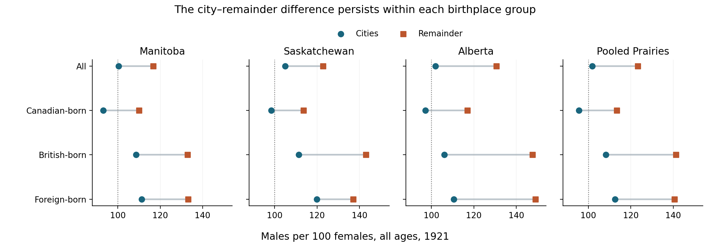
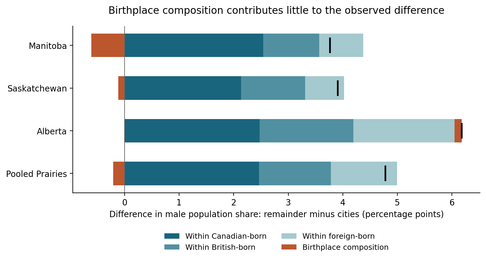

# Where the male surplus lived: birthplace and the geography of the Canadian Prairies in 1921

Independent exploratory research draft, 7 September 2026. Prepared by Codex for external historical review. Version 1.

The Canadian Prairies' male population surplus in 1921 was overwhelmingly located outside their incorporated cities. Seventeen cities contained 23.5 percent of the population but only 2.6 percent of the region's net excess of males over females. This paper asks whether their relatively balanced populations resulted from a different mixture of Canadian-, British-, and foreign-born residents. A decomposition of the census counts finds that differences within these birthplace categories account for 4.993 percentage points of the 4.783-point difference in male population share between cities and the provincial remainder. Birthplace composition offsets 0.210 points. The result survives alternative settlement definitions and comparisons within census divisions. Its contribution is a reproducible measurement of the limited explanatory power of three broad birthplace shares, and of the substantial Canadian-born component of the divide. It does not identify migration flows or establish their causes. Earlier census analysts recognized sex differences in urban concentration; this paper extends that observation quantitatively rather than claiming to discover it.

The starting puzzle is the coexistence of a pronounced regional male surplus with nearly balanced city populations. Manitoba, Saskatchewan, and Alberta together reported 1,058,475 males and 897,607 females in 1921: approximately 118 males per 100 females. Their seventeen cities reported 231,649 males and 227,501 females, or approximately 102 per 100. The remaining population had approximately 123 males per 100 females. These are counts of all ages, including children. Neither a surplus nor a ratio here describes the availability of marriage partners. The underlying provincial statements can be inspected directly in the preserved source rows for [Manitoba](https://jimclifford.ca/hgiscanada/sources/1921_V1T16_PUB_202306/rows/3877/#cell-H), [Saskatchewan](https://jimclifford.ca/hgiscanada/sources/1921_V1T16_PUB_202306/rows/4086/#cell-H), and [Alberta](https://jimclifford.ca/hgiscanada/sources/1921_V1T16_PUB_202306/rows/4912/#cell-H).

This coexistence matters because a regional account of settlement can obscure the distribution of people within the region. An explanation based on male immigration might seem sufficient when looking at western provincial totals. At a smaller scale, however, two different propositions require separation. Cities might have fewer people belonging to birthplace groups with high male proportions. Alternatively, the same broad birthplace groups might have different sex balances inside and outside cities. Both can operate together. Their relative magnitudes are measurable even when the causes of the differences remain uncertain.

Historians have already established that women occupied important, contested places in the urban West. Lindsey McMaster's *Working Girls in the West* examines representations of wage-earning women and their difficult fit within ideals of settlement and domesticity. Her introduction explicitly distinguishes that representational inquiry from a history of what all working women actually did. A population accounting can supply complementary evidence about where females were enumerated, but these census cells cannot identify McMaster's working women individually or count their occupations. [McMaster, introduction, pp. 3–8](https://www.ubcpress.ca/asset/9141/1/9780774814553.pdf).

The demographic observation is older still. The Dominion Bureau of Statistics' 1929 monograph on origins and birthplace observed greater female urban concentration within almost every immigrant birthplace group. It proposed work opportunities, male mobility and the conditions of rural life as possible explanations while acknowledging the difficulty of assigning their relative importance. That discussion, embedded in the report's assimilationist and racial classifications, is an essential predecessor rather than a neutral account to repeat uncritically. Joseph A. Norland later emphasized both internal and international migration in explaining historical regional sex ratios, using birthplace and immigration-period evidence more detailed than the three categories available here. Neither passage is evidence that the present numerical decomposition is unprecedented. They establish that the underlying demographic mechanisms and the importance of looking within birthplace categories were already understood. [Dominion Bureau of Statistics, 1929, pp. 111–12](https://publications.gc.ca/collections/collection_2017/statcan/CS98-1921M-4-eng.pdf); [Norland, 1976, pp. 11–12](https://publications.gc.ca/collections/collection_2017/statcan/CS99-703-1971.pdf).

The source for this investigation is Table 16 of the first volume of the 1921 census, queried through the current HGIS Canada preservation of the Canadian Peoples/TCP workbook `1921_V1T16_PUB_202306`. Its nine statistical columns contain population totals and male and female counts for three birthplace groups. The Canadian Century Research Infrastructure documents the digitization of this table and explains that transcription sometimes involved corrections to printed values, with reasons recorded in notes. A preserved workbook is therefore an evidentiary edition, not an assurance that every entry reproduces print without editorial intervention. [Source catalogue](https://jimclifford.ca/hgiscanada/sources/1921_V1T16_PUB_202306/); [CCRI documentation](https://ccri.library.ualberta.ca/endatabase/geography/digitizedpublictables/index.html).

The geographical design deliberately stays within one census and one table. The primary city group consists of every Prairie subdivision whose source label ends in “, C”: four cities in Manitoba, seven in Saskatchewan and six in Alberta. These are the table's designated cities, not present-day municipalities, metropolitan areas or a population-size selection. The comparison group is each provincial total minus its cities. It includes towns, villages, suburban municipalities, reserves, organized rural municipalities and unorganized areas. Throughout the primary analysis, “remainder” means this mixed population. It must not be silently renamed “rural.” The full roster and exact source cells accompany the paper in [cities.csv](cities.csv) and [main_citations.csv](main_citations.csv).

All 180 cells required for the seventeen cities and three provinces are numeric and satisfy the relevant accounting identities. The provincial remainder can therefore be calculated without interpreting local blanks. Across all 1,519 Prairie subdivision rows, recorded numeric subtotals also reconcile to the provincial totals in all nine columns. The analysis independently re-read the 180 main cells from the original workbook, checked 54 values in six city rows against images of the printed census, and reconciled broader urban population totals with a second table. These checks establish agreement along the inspected evidence chain, not the completeness of the 1921 enumeration. [Independent validation](independent_validation.json); [printed Table 16, pp. 313, 320, 332 and 335](https://publications.gc.ca/collections/collection_2017/statcan/CS98-1921-1-1924.pdf).

Table 1 shows the size and direction of the difference. The Canadian-born had a female majority in the pooled cities and a male majority in the remainder. Both categories born outside Canada had male majorities on each side, but markedly higher ratios outside cities. An account based solely on placing foreign-born males in the countryside misses this parallel pattern among the Canadian- and British-born.

**Table 1. Population by birthplace and sex, Prairie cities and provincial remainder, 1921.**

| Census birthplace category | City males | City females | City males per 100 females | Remainder males | Remainder females | Remainder males per 100 females |
|---|---:|---:|---:|---:|---:|---:|
| Canadian-born | 123,053 | 128,738 | 95.6 | 482,964 | 425,914 | 113.4 |
| British-born | 66,530 | 61,417 | 108.3 | 108,275 | 76,639 | 141.3 |
| Foreign-born | 42,066 | 37,346 | 112.6 | 235,587 | 167,553 | 140.6 |
| All | 231,649 | 227,501 | 101.8 | 826,826 | 670,106 | 123.4 |

*Source: calculations from the current Table 16 source cells. Full precision and provincial results: [ratios.csv](ratios.csv). British-born and foreign-born are separate historical census categories; “foreign-born” in this table does not include all people born outside Canada.*

The pooled figures conceal a revealing cancellation. British- and foreign-born city residents together contributed an excess of 9,833 males. A Canadian-born excess of 5,685 females offset 57.8 percent of that excess, leaving the cities with a net male surplus of 4,148. In the provincial remainder, all three groups contributed to the 156,720 male surplus. Thus, 97.4 percent of the region's net male surplus lay outside the seventeen cities, even though those cities accommodated almost a quarter of its people. This percentage describes a distribution of a net difference, not a proportion of individual males or a count of missing females.

The Canadian-born reversal was geographically widespread. Fourteen of the seventeen cities had more Canadian-born females than males; North Battleford, Lethbridge and Red Deer were the exceptions. Only St. Boniface, Weyburn and Medicine Hat had overall female majorities. Winnipeg illustrates the distinction particularly clearly: its Canadian-born population included 3,528 more females than males, while its total population included 387 more males than females. Calgary similarly combined a Canadian-born female surplus of 931 with an overall male surplus of 347. These examples explain why total city ratios alone understate the differences between birthplace groups. They do not show that the Canadian-born females were recent migrants or wage earners. [Winnipeg](https://jimclifford.ca/hgiscanada/sources/1921_V1T16_PUB_202306/rows/3959/#cell-J); [Calgary](https://jimclifford.ca/hgiscanada/sources/1921_V1T16_PUB_202306/rows/5104/#cell-J).

*Figure 1. All-age male-to-female ratios. The dotted line marks equal counts. “Remainder” is the provincial population outside the source-designated cities.*

To distinguish birthplace composition from differences within categories, the analysis decomposes the proportion male, rather than the male-to-female ratio. A population's male proportion is the weighted average of its birthplace-specific male proportions, with weights equal to each category's population share. The symmetric two-component decomposition assigns part of the city–remainder difference to changing these shares and part to changing male proportions within categories. Averaging the two possible orders avoids privileging either area's distribution. The two contributions sum exactly to the observed difference. This is a standard demographic accounting method, not a new estimator. The formulas and a calculation in the alternative two-order form are supplied in the [methods appendix](METHODS.md). [Kitagawa, 1955](https://doi.org/10.1080/01621459.1955.10501299).

**Table 2. Decomposition of the difference in male population share, remainder minus cities.**

| Area | Observed difference, percentage points | Differences within birthplace groups | Birthplace composition | Within-group component as percent of observed difference |
|---|---:|---:|---:|---:|
| Manitoba | 3.764 | 4.373 | −0.609 | 116.2% |
| Saskatchewan | 3.909 | 4.023 | −0.114 | 102.9% |
| Alberta | 6.178 | 6.048 | 0.131 | 97.9% |
| Pooled Prairies | 4.783 | 4.993 | −0.210 | 104.4% |

*Source: [decomposition.csv](decomposition.csv). Components can exceed 100 percent when the other component offsets the observed difference. These are accounting contributions, not causal percentages.*

The answer is consistent across the provinces. In Manitoba and Saskatchewan the birthplace mix actually reduced the observed difference. In Alberta it contributed only 0.131 percentage points to a 6.178-point difference. At the pooled level, differences within the Canadian-born category supplied 2.466 points, compared with 1.318 for the British-born and 1.209 for the foreign-born. The Canadian-born component thus represented 49.4 percent of the within-group component. These proportions depend on the explicitly stated decomposition and categorization; they are not estimates of the causal importance of internal migration.

*Figure 2. Positive bars increase the city–remainder difference; negative bars offset it. Black ticks mark the observed differences. The three blue components describe differences within the census birthplace categories.*

Several checks test whether the finding depends on the particular city selection. Removing Winnipeg from the comparison entirely leaves a difference of 4.563 percentage points, with a within-group component of 4.670 points. Selecting only the nine cities with at least 10,000 people produces the same substantive result. Including all 656 source-designated cities, towns and villages produces a 4.650-point urban–rural difference and a 4.733-point within-group component. Their population totals match the separately published provincial urban populations exactly: 261,616 in Manitoba, 218,958 in Saskatchewan and 222,904 in Alberta. That independent agreement supports the wider classification, while leaving the primary city–remainder comparison conceptually distinct.

The broader analysis requires an explicit treatment of blanks. Of 656 urban rows, 628 have all nine counts recorded numerically. For the other 28, the accounting-derived-zero sensitivity uses only zeros uniquely implied when nonnegative category counts exhaust a recorded total. It preserves the original blanks in the evidence extract. The complete-record comparison gives virtually the same decomposition without those derivations. All 68 urban units with populations of at least 1,000 have complete records. Results for each definition, and all seventeen leave-one-city-out calculations, are supplied in [sensitivity.csv](sensitivity.csv).

**Table 3. Selected sensitivity checks, pooled Prairies.**

| Selected population compared with its remainder | Selected units | Difference, percentage points | Within-group component | Composition component |
|---|---:|---:|---:|---:|
| All designated cities | 17 | 4.783 | 4.993 | −0.210 |
| Cities of at least 10,000 | 9 | 4.735 | 4.955 | −0.220 |
| Cities, Winnipeg omitted from both population universe and selection | 16 | 4.563 | 4.670 | −0.107 |
| Urban units of at least 1,000, complete records | 68 | 4.612 | 4.783 | −0.171 |
| Cities, towns and villages, complete records | 628 | 4.643 | 4.725 | −0.083 |
| All cities, towns and villages, accounting-derived zeros | 656 | 4.650 | 4.733 | −0.083 |

The divide also survives a comparison within the fourteen census divisions containing these cities. Each division's city population has a lower male proportion than its own remainder. Within-group contributions account for between 88.1 and 132.4 percent of the division-specific differences. These comparisons use the table's own provincial and division fields; no external geographic code is treated as proof of identity. The pattern is not universal in every birthplace group: foreign-born residents in Prince Albert and North Battleford have higher male proportions than their respective division remainders. Reporting these exceptions matters. The overall regularity does not warrant inventing a uniform experience for every immigrant population. [Division results](within_divisions.csv).

What does this add historically? It establishes a measured limit to an explanation of the Prairie city–remainder divide based on the relative abundance of the census's three birthplace populations. Holding those broad shares comparable does not remove the difference. The cities' Canadian-born female surplus and the remainder's Canadian-born male surplus also place the Canadian-born population near the centre of this particular spatial accounting. The results support an account of uneven settlement in which the location of males and females within broad birthplace populations matters at least as much as their provincial mixture. They add magnitudes, local comparisons and a reproducible evidentiary chain to a recognized historical phenomenon.

They cannot determine why the differences arose. The Canadian-born include people born in other provinces, people born locally, children of immigrants, Indigenous people and residents with many different histories. Their imbalance could reflect internal migration, emigration, differences in age composition and mortality, or combinations of these. Within the foreign-born category, detailed countries of birth and immigration cohorts may differ sharply between places. A small three-category composition component does not establish a small composition component under a much finer classification. Nor does it demonstrate that immigration was unimportant: migration processes can shape both population shares and sex balances within them.

Age is a particularly important unmeasured dimension. Because these counts combine children and adults, birthplace-specific differences in age composition could contribute to the patterns attributed here to differences within birthplace categories. The counts cannot isolate wartime deaths, the influenza pandemic, employment structures, marriage, or family reunification. A city–country association is compatible with several mechanisms and cannot choose among them. The next discriminating evidence would be individual or finely cross-tabulated age, birthplace, occupation and marital-status data, linked to evidence of movement. That is a proposal for a subsequent study, not a result of this one.

The census is also a colonial record of a settler state. Its birthplace divisions do not describe three homogeneous social groups, and Canadian birth does not identify settler status or Indigenous identity. The table separately labels reserve reporting units and notes that their populations can include white residents. Those units remain in the provincial remainder. Their inclusion avoids discarding enumerated people, but does not make the resulting analysis an adequate account of Indigenous demography or demonstrate complete enumeration. The paper's claim concerns the population as represented in these particular source statements.

This is an exploratory study, developed after inspecting the available variable inventory and preliminary distributions. It was not preregistered. The literature examination located close conceptual predecessors, including contemporary census analysis; it cannot certify priority for the calculations reported here. The strongest defensible claim is a quantitative extension: in this 1921 Prairie comparison, the three broad birthplace shares explain very little of the geographical difference in male population share, while differences within the Canadian-born population contribute substantially. Whether that extension constitutes a significant contribution to historical knowledge should be decided through critical comparison with the fuller literature, not inferred from the size or precision of the calculations.

All reported results can be reproduced using the [analysis script](analyze.py), [independent verification](verify.py), and [methods appendix](METHODS.md). The evidence extract retains the original values and statuses, variable definitions, reference years, reporting geography, workbook checksum, RDF identifiers and supplied cell citation URLs. No older research papers or prior analyses in the repository were consulted, and no publication data were modified.
